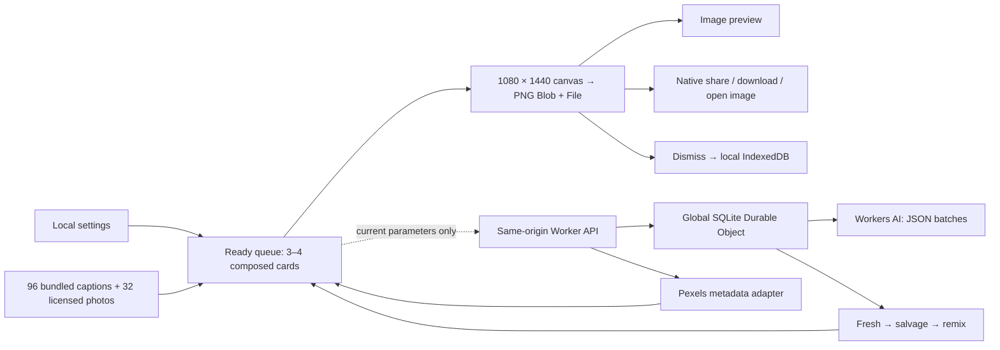

# MoodSwipe architecture

## Data flow

The client always has curated content available. By operator request, an online launch waits for its first AI response behind a spinner before composing the first card. Offline launches immediately compose local content; disabled, failed, exhausted, or unusable AI results fall back after the response. Later swipes use the ready queue while generation runs in the background. Current cards are preserved when new batches arrive.

## Boundaries and contracts

- `shared/types.ts`: parameters, captions, provenance, photos, layouts, cards.
- `shared/quality.ts`: schema checks, normalization/fingerprints, word-bigram similarity, opening/concept cooldowns, salvage eligibility, fallback priority, remix caps. It is used at both the server and browser trust boundaries.
- `src/lib/composition.ts`: crops photographs to 1080 × 1440, loads the selected bundled font, measures wrapping, rotates seven treatments across six font families within each mood, balances wrapping, samples a 108 × 144 glyph mask for local contrast, penalizes metadata subject overlap and recent placement/alignment, chooses white or dark text with an optional outline/gradient, and creates a PNG. Captions that cannot fit are rejected; no ellipsis/truncation is used. The caption zone ends above the controls. There is no DOM caption in an exported image.
- `src/data/photo-manifest.json` is the shared photo acquisition/provenance manifest. `src/data/photos.ts` avoids the last 12 backgrounds, then weighs aesthetic and atmosphere keywords. Literal caption references constrain subject matching; a constrained subject pool rotates least-recently-used photographs when exhausted.
- `src/lib/queue.ts`: serial composition, at most four ready cards including the current card, reduced to three with Save-Data or low device-memory signals. Revision tokens invalidate in-flight results and queued cards after settings changes. Current and rejected cards retain their parameters.
- `src/lib/supply.ts`: asynchronously fetches validated captions/photos and uses cached in-memory supply. Demand-driven one-shot retries honor server pacing, rate limits, provider circuits and daily exhaustion. Transient browser/network errors retry after 30 seconds. Timers run only online and visible, and expire two minutes after the last browsing action. Health configuration is refreshed after 30 seconds when needed; visibility/reconnection and explicit retry resume demand. No endless interval polling. No user history is sent.
- `src/lib/export.ts`: synchronously reaches `navigator.share` with an already prepared File. No image loading or canvas work occurs before requesting the share sheet. AbortError means canceled. Other errors retain the card. Download initiation is reported truthfully; open-image Save advances only after user confirmation. Share never advances, including its fallback.
- `worker/providers.ts`: `CaptionProvider.generate(params, recentGenericCaptions, remainingTimeMs?)` returns untrusted candidates. Workers AI uses server-owned prompts, JSON schema output, a 45-second generation deadline shared across attempts, 2,200 output-token cap, and the configured model. The browser allows 50 seconds for inference; online startup shows a spinner and later requests run behind the usable feed. Live inference took about 31 seconds during rollout, which exceeded the original 18-second limit. The timeout bounds waiting but cannot guarantee provider-side cancellation; every attempt is reserved against the budget before the call.
- `worker/photos.ts`: `PhotoProvider.search(keyword, aesthetic)` returns provenance-bearing photo metadata. Searches are restricted to curated keywords, metadata URLs to Pexels hosts, and obvious identifiable-person results are excluded. Metadata filtering is not full computer vision. Photos load directly from Pexels with anonymous CORS; no open image proxy exists.

`POST /api/generate` accepts exactly `{ "params": Parameters }`. It rejects custom prompts and extra fields, streams no more than 2 KB of input, and returns at most 12 captions with source `llm`, `salvage`, or `remix`, plus a precise retry interval and safe fallback reason (`paced`, `daily_budget`, `provider_unavailable`, `disabled`, or `filtered`). Browser-local recent IDs filter repeats without being uploaded. `POST /api/photos` accepts only `{ "keyword": <allowlisted word>, "aesthetic": <enum> }`. `GET /api/health` reports configuration flags without exposing secrets or making billable provider calls.

## Storage

| Store                        | Location                        | Bound / lifecycle                                                                                         |
| ---------------------------- | ------------------------------- | --------------------------------------------------------------------------------------------------------- |
| Ready cards                  | Browser memory                  | 3–4 PNGs; dropped queues revoke object URLs                                                               |
| Settings                     | LocalStorage                    | One validated parameter object                                                                            |
| Visual history               | LocalStorage + IndexedDB `meta` | Last 24 displayed photo IDs and six type/placement choices; synchronous small write prevents reload races |
| Recent fingerprints          | IndexedDB `meta`                | Last 200 caption IDs; local only                                                                          |
| Rejected                     | IndexedDB `rejected`            | 100 cards / 100 MB / 30 days; oldest first                                                                |
| Offline shell, fonts, photos | Service-worker precache         | Versioned build, approximately 4.8 MiB; old caches cleaned                                                |
| Generic candidates / reasons | SQLite Durable Object           | About 200 candidates, 150 recent generic captions, seven-day retention checked on use/alarm               |
| Rate limits                  | Same Durable Object             | Bounded map of short-lived counters and daily salted hashes; no raw IP stored                             |
| Photo search responses       | Cloudflare Cache API            | Public generic metadata cached for 24 hours; no per-user information                                      |

IndexedDB schema v2 stores PNG bytes as ArrayBuffer for WebKit compatibility, retaining v1 Blob-record readability. Store transactions prune old records and retry a quota failure with additional oldest-first eviction. A persistent failure leaves the visible card intact and reports the problem. Storage unavailability does not stop generation or export, but prevents durable dismissal; the app says so.

Saving does not create a gallery or remove rejected records. Rejected history is never sent to the Worker, AI, or photo provider. Each rejected record contains its exact PNG, caption, provenance, parameters, layout, and timestamp, so offline sharing does not need the original photo URL to remain valid.

## Generation and fallback

The writer requests eight complete captions, using a concise writing brief, mood-specific editorial direction, examples, distinct human situations, and a setup/payoff test. Photo keywords are selected after the writing as atmosphere hints. The lightweight validator rejects known stock phrases and scenery fragments; it cannot measure humor or guarantee originality. `EDITORIAL_VERSION` invalidates obsolete generic pools without resetting attempts or rate limits. The provider remains Workers AI / Llama 3.3 70B, with no new credentials or paid-provider fallback.

1. Valid fresh unused shared candidates are served first. When supply is low, the global generator is paced to at most one generation cycle per 15 seconds and a default 500 inference attempts per UTC day for testing (operator configurable, hard ceiling 10,000). Provider quotas still apply.
2. Candidates withheld only for temporary opening/concept similarity or photo mismatch enter salvage. They need a 30-minute cooldown; photo mismatch additionally requires compatible photo terms. Unsafe, generic, too-long, and duplicate rejects are counted and discarded, never salvaged.
3. Previously strong delivered candidates may be offered as remixes after an hour, at most twice after their original delivery. Client photo-history penalties favor a different photograph; the composition is recomputed. Provenance remains explicit, and local recent IDs can further suppress these repeats.
4. If a request produces no usable candidates, the client composes curated local captions. This also covers disabled providers, timeouts, quotas, invalid JSON, filtering, HTTP errors, and offline operation.

The small bundled photo vocabulary is deliberately conservative. A photo-mismatch candidate remains withheld until a compatible term is available; there is no promise that every salvage candidate will eventually be used. Optional embeddings, face detection, and semantic moderation models are not dependencies. Safety/quality filtering is heuristic plus a constrained generation prompt, not a certification of every model output.

## Security and operations

A single named Durable Object serializes quota mutations globally; it reserves each inference attempt before provider I/O. Retried transient failures consume another budget unit and share the original 45-second deadline. Authentication/quota errors and timeouts open a 15-minute circuit; repeated transient errors do likewise. The maximum retry count is one, with exponential-delay/jitter infrastructure. Changing the configured model or generation deadline clears the stale circuit while preserving the daily spending ledger and generation pacing. No alternative paid provider is contacted.

The Worker checks exact origins, methods, content type, body size, enums, and extra fields. The same origin is allowed automatically; explicit additional origins are optional. It accepts no arbitrary prompt, URL, model name, or secret from the browser. The anonymous limit is six API budget/generation requests per minute per daily IP-derived hash and sixty globally; provider-specific daily limits are additional. An attacker can spoof an Origin outside a browser or distribute requests across IPs. CORS is not authentication, and quotas remain the spending boundary.

The Worker forwards an IP transiently to the internal Durable Object; a random salt is generated and stored there, rotated daily. Only its hash enters the limiter state. Request bodies and raw IPs are not application-logged. Built-in observability is disabled; platform operational metadata still exists. Static assets are routed independently of `/api/*`, so backend quota failures do not disable cached or directly served static files.

CSP restricts scripts/fonts to this origin, image connections to this origin/blob/Pexels, disallows embedding and plugins, and disables camera/microphone/geolocation. UI output is canvas text or React-escaped strings. Provider credentials never enter frontend imports or build-time variables. Production frontend source maps are disabled.
